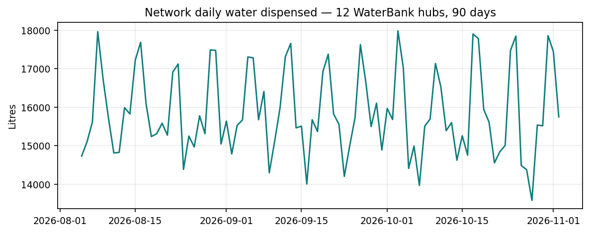
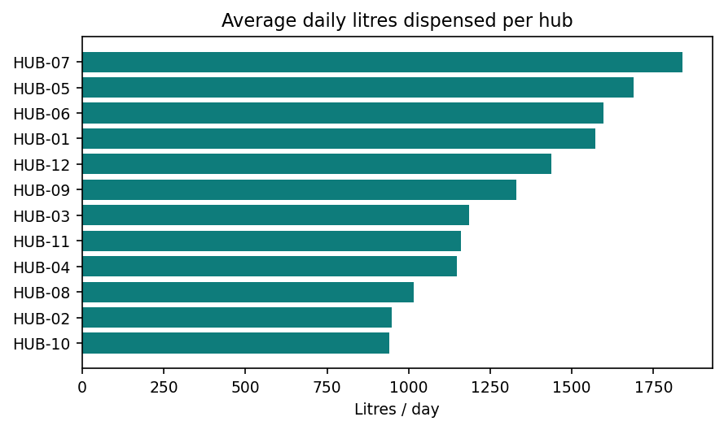
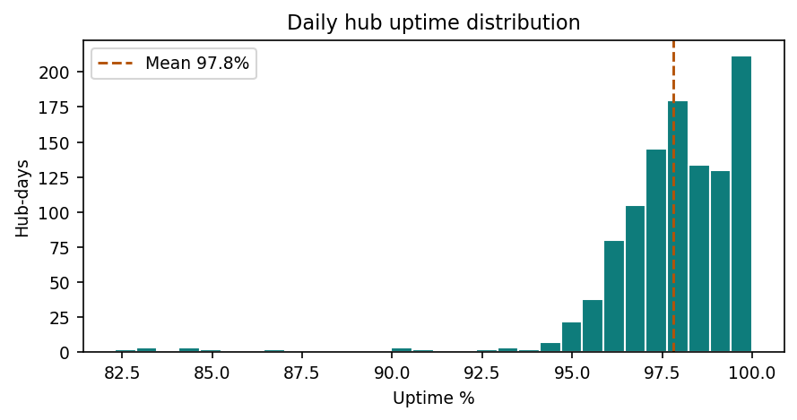
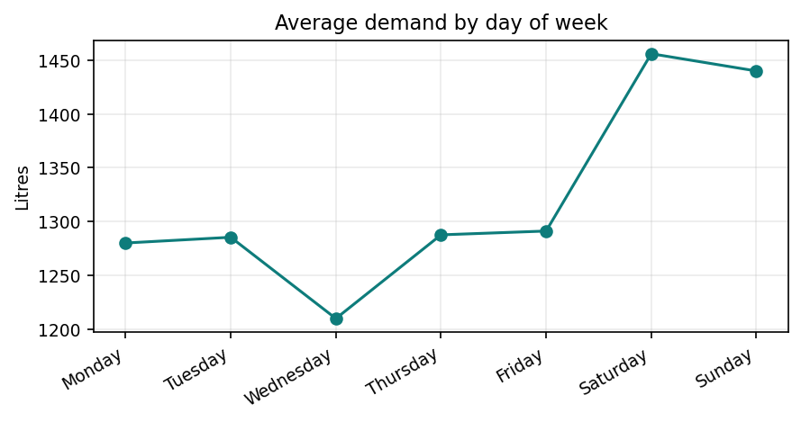
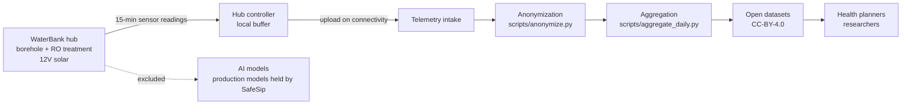

# SafeSip WaterBank: Open Data and AI

Open, anonymized operational data from SafeSip's solar-powered WaterBank hubs in
Tanzania, together with documentation of the small AI system that runs each hub.
Published so that water-sector partners, researchers, public-health planners and
builders of AI for off-grid infrastructure can work from real operating evidence.

## What this is

SafeSip operates solar-powered WaterBank hubs that provide safe drinking and
domestic water to off-grid communities. Each hub logs water production,
dispensing, quality and uptime through onboard sensors, and a small AI system
running on the hub itself manages demand, queues and maintenance. This
repository publishes the anonymized, aggregated layer of the hub telemetry as
open data, and documents how the AI layer works.

Intended uses:

- Planning water services for rural and peri-urban communities
- Correlating water access with health outcomes, and planning clinic outreach
  around reliable water points
- Research on off-grid water service reliability
- Building and testing small, offline-first AI models for rural infrastructure

## The AI at each hub

3 small models run each hub, all of them on the device, with no cloud and no
frontier model behind them:

- AI Queue counts the people waiting at the hub and corrects the demand
  forecast with the live count. It stores no faces and no images: all that
  leaves the hub is a number. On long queues it applies a fair-share rule,
  a 20L container per turn, so no household is crowded out.
- Demand forecasting, a time-series model trained on the hub's own card
  transactions, predicts each community's daily draw so that treatment and
  storage are ready in advance.
- Predictive maintenance reads membrane pressure and detects clogging at
  95% accuracy, so the hub cleans itself or calls a technician before it fails.

The models run on Qualcomm Dragonwing QRB2210 hardware, built with Qualcomm
AI Hub and Edge Impulse, with an Arduino Uno Q controlling dispensing and
filtration. Hubs are 100% solar with 5-day battery backup, and the firmware is
offline-first: it stores transactions on the hub and syncs when connectivity
returns.

## What is open, and what is not

Published in this repository, and growing under SafeSip Foundation's open
programme:

- Data: anonymized demand, queue and quality datasets (CC BY 4.0)
- Code: the anonymization and aggregation tooling in `scripts/` (MIT), with
  the dispensing firmware, the AI Queue counting system and the model
  training pipelines to follow in this repository
- Methods: the methodology notes in `docs/`, with designs, benchmarks and a
  public evaluation to follow, including a trained reference model with
  its weights
- Learning: guides and training materials as they are produced (CC BY 4.0)

The boundary is plain: the trained production models running SafeSip's own
network stay SafeSip's operating asset. Everything the open programme produces
is published here, so the knowledge is public.

## Repository layout

- `data/` - published datasets and the data dictionary
- `data/sample/` - small synthetic sample illustrating the schema
- `scripts/` - anonymization and aggregation tooling
- `notebooks/` - example analyses
- `docs/` - methodology notes

## Data

See `data/README.md` and `data/data_dictionary.md`. Production datasets are
populated from hub telemetry; the `data/sample/` files illustrate the schema
with values representative of typical hub performance.

## Data at a glance

Sample window: 12 hubs, 90 days (Aug-Nov 2026).

## System overview

## License

- Code in `scripts/` and `notebooks/`: MIT License (see `LICENSE`)
- Datasets in `data/`: Creative Commons Attribution 4.0 International (see `LICENSE-DATA.md`)
- Documentation and methodology notes: Creative Commons Attribution 4.0 International

## Contributing

Issues and pull requests are welcome. If you use this data in published work,
please cite SafeSip and link back to this repository.

## Contact

SafeSip - https://safesip.co.tz - cto@safesip.co.tz
