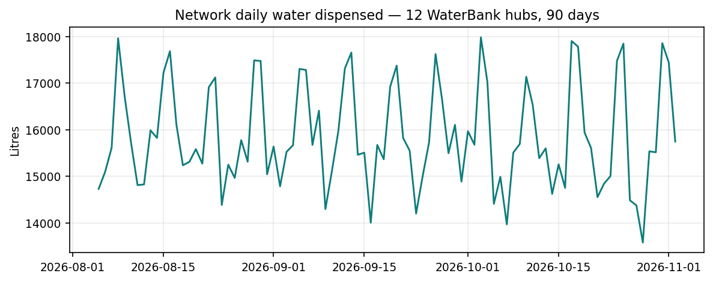
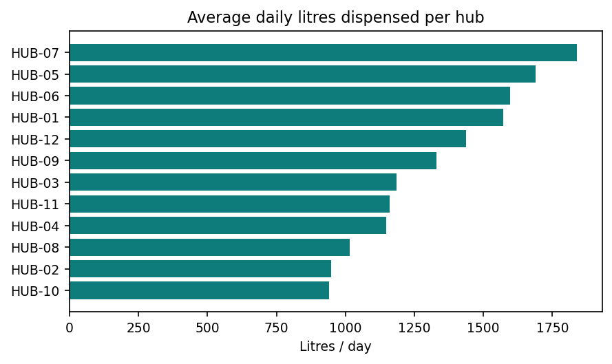
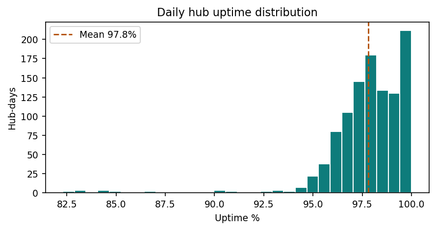
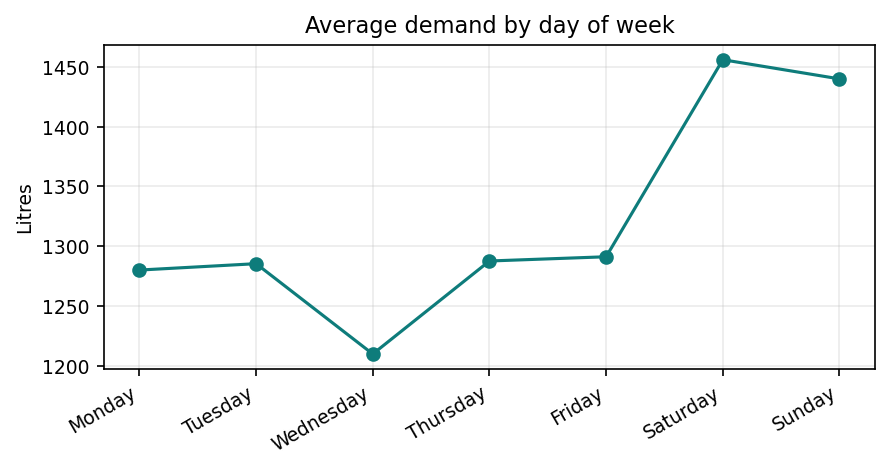
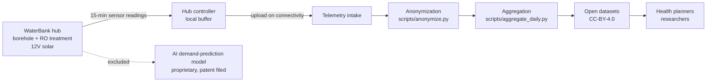

# SafeSip WaterBank — Open Data

Open, anonymized operational data from SafeSip's solar-powered WaterBank hubs in
Tanzania. Published so public-health planners, researchers, and water-sector
partners can plan maternal and child health interventions around real drinking-water
demand.

## What this is

SafeSip operates solar-powered WaterBank hubs that provide clean drinking water to
off-grid communities. Each hub logs water production, dispensing, quality, and
uptime through onboard IoT sensors. This repository publishes the anonymized,
aggregated layer of that telemetry as open data.

Intended uses:

- Correlating drinking-water access with maternal and child health outcomes
- Planning clinic outreach, vaccination drives, and nutrition programs around
  reliable water points
- Water-resource planning for rural and peri-urban communities
- Research on off-grid water service reliability

## Repository layout

- `data/` - published datasets and the data dictionary
- `data/sample/` - small synthetic sample illustrating the schema
- `scripts/` - anonymization and aggregation tooling
- `notebooks/` - example analyses
- `docs/` - methodology notes

## Data

See `data/README.md` and `data/data_dictionary.md`. Production datasets are
populated from hub telemetry; the `data/sample/` files illustrate the schema
with values representative of typical hub performance.

## Data at a glance

Sample window: 12 hubs, 90 days (Aug-Nov 2026).

## System overview

## License

- Code in `scripts/` and `notebooks/`: MIT License (see `LICENSE`)
- Datasets in `data/`: Creative Commons Attribution 4.0 International (see `LICENSE-DATA.md`)

## Contributing

Issues and pull requests are welcome. If you use this data in published work,
please cite SafeSip and link back to this repository.

## Contact

SafeSip - https://safesip.co.tz - cto@safesip.co.tz
